# Introducing Aurea OS

  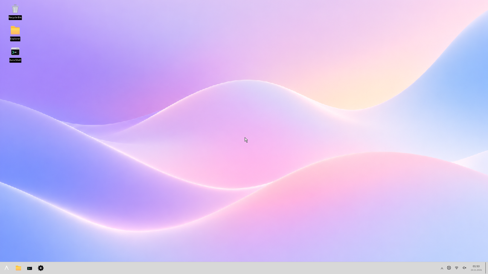

Aurea OS is an independently developed 64-bit operating system built around its own Zero Core architecture, the Horizon desktop environment, and a long-term vision of native system execution alongside isolated application compatibility environments.

It is a single-developer project. AI-assisted engineering tools are used throughout development; the architecture, technical direction and project decisions are my own.

> **Aurea OS Milestone 1 is an experimental developer preview. It is not suitable for daily use.**
> Run it in a virtual machine. Do not store anything important in it.

## Contents

- [What is Aurea OS?](#what-is-aurea-os)
- [Milestone 1 overview](#milestone-1-overview)
- [Screenshots](#screenshots)
- [What currently works](#what-currently-works)
- [Known limitations](#known-limitations)
- [Language, keyboard and fonts](#language-keyboard-and-fonts)
- [Zero Core architecture](#zero-core-architecture)
- [Horizon desktop](#horizon-desktop)
- [Download and quick start](#download-and-quick-start)
- [Running Aurea in QEMU](#running-aurea-in-qemu)
- [Experimental USB boot](#experimental-usb-boot)
- [Aurea SDK](#aurea-sdk)
- [Building and installing applications](#building-and-installing-applications)
- [Aura terminal and command registry](#aura-terminal-and-command-registry)
- [GNU Bash and Linux integration](#gnu-bash-and-linux-integration)
- [SoftCPU](#softcpu)
- [Performance and stability](#performance-and-stability)
- [Security warning](#security-warning)
- [Current development focus](#current-development-focus)
- [Long-term architecture](#long-term-architecture)
- [Developer and credits](#developer-and-credits)
- [Licensing](#licensing)

## What is Aurea OS?

Aurea OS is not a Linux distribution and not a fork of another operating system. It has its own UEFI boot loader, kernel, scheduler, memory management, virtual file system, window system, desktop and command environment. It runs on x86-64 PCs with UEFI firmware.

Linux appears in Aurea OS in one specific role: as a guest in a hardware-isolated virtual machine, the **Linux driver domain**, which is meant to supply device drivers under Zero Core's control. Linux is not the Aurea kernel and is not intended to become it.

Aurea OS is not a replacement for Windows, Linux or macOS, and Milestone 1 does not try to be.

## Milestone 1 overview

| | |
|---|---|
| Release | Milestone 1 — First Public Developer Preview |
| Build | 0.02.0-alpha, build 02416 |
| Platform | x86-64, UEFI only |
| Recommended environment | QEMU on Windows or Linux |
| Real hardware | Experimental; see [docs/HARDWARE_BOOT.md](docs/HARDWARE_BOOT.md) |
| Development login | user `aura`, password `root` |

This repository holds the public documentation, the launch and USB tools, and the SDK. The operating system itself is distributed as a disk image on the [release page](../../releases). The Aurea OS source code is not public.

Status labels used throughout the documentation:

- **Verified**: tested in this exact release build.
- **Partial**: implemented, but incomplete, unstable or only verified in some environments.
- **Experimental**: an engineering capability with significant limitations.
- **Planned**: not delivered in Milestone 1.
- **Not verified**: there is not enough evidence to say.

## Screenshots

All screenshots were taken from the release image. The Bash screenshot comes from QEMU 8.2 with KVM on Linux (WSL 2), the others from QEMU 11 on Windows. None of them are mock-ups.

| | |
|---|---|
| 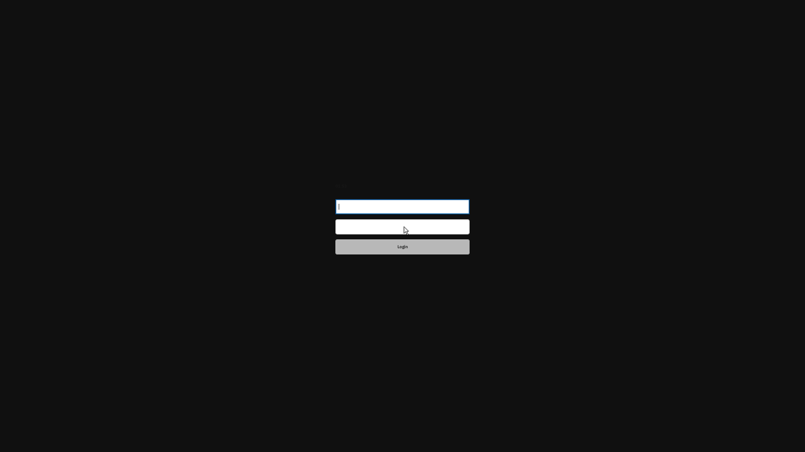 Login | 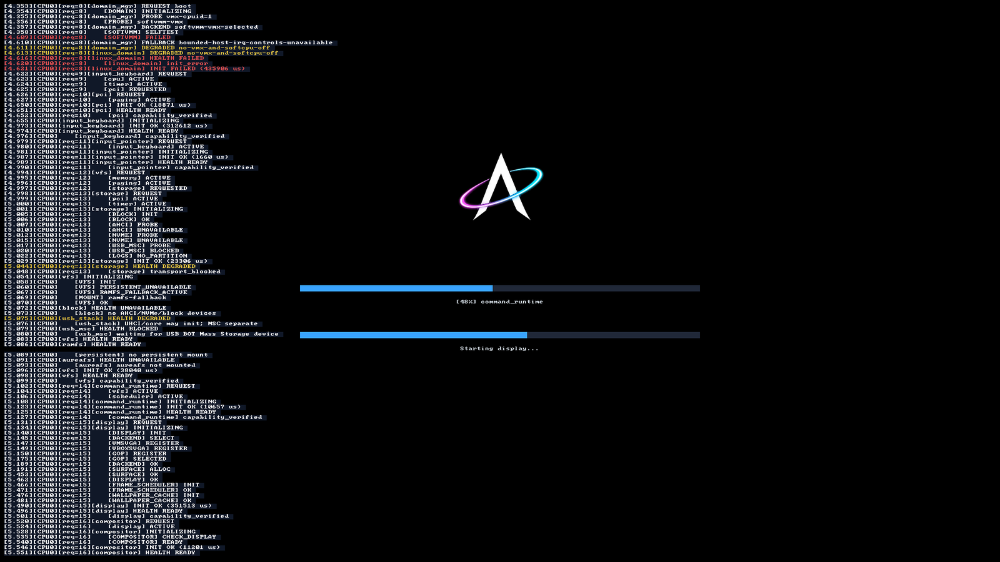 Boot progress |
| 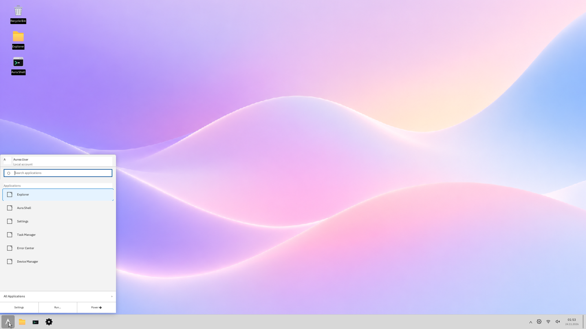 Start menu |  Aura terminal, `help` |
|  An SDK-built program, downloaded and run | 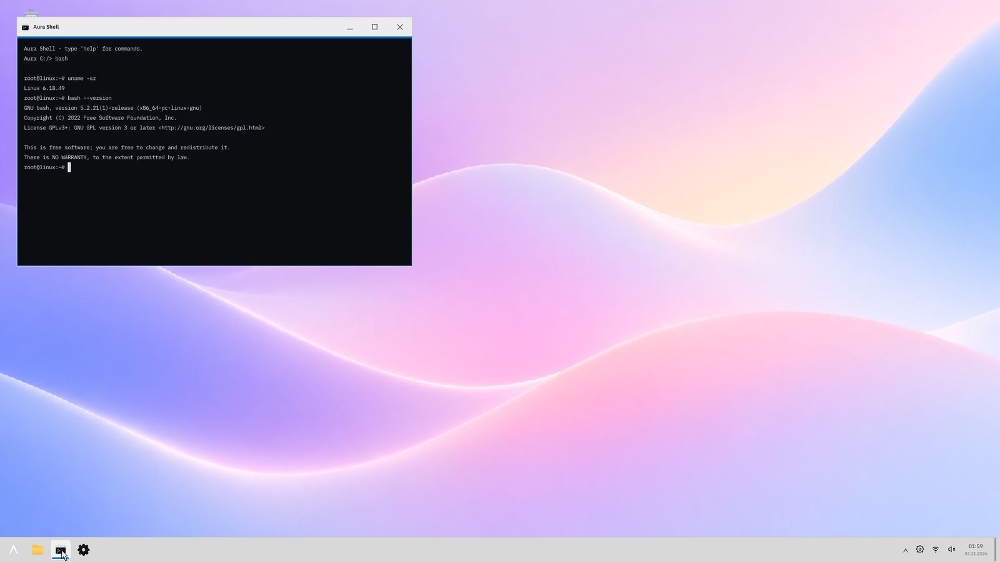 GNU Bash in the Linux driver domain (QEMU/KVM on Linux) |
| 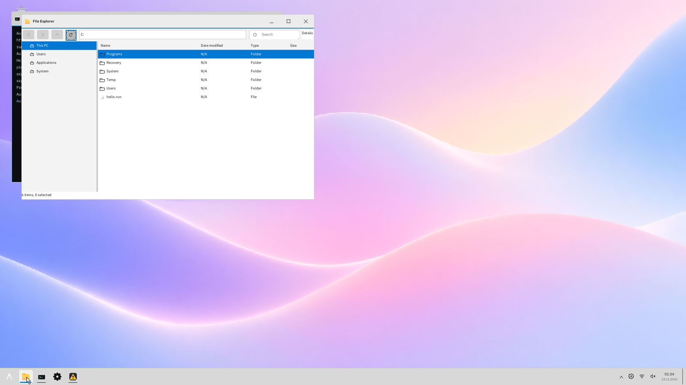 File Explorer | 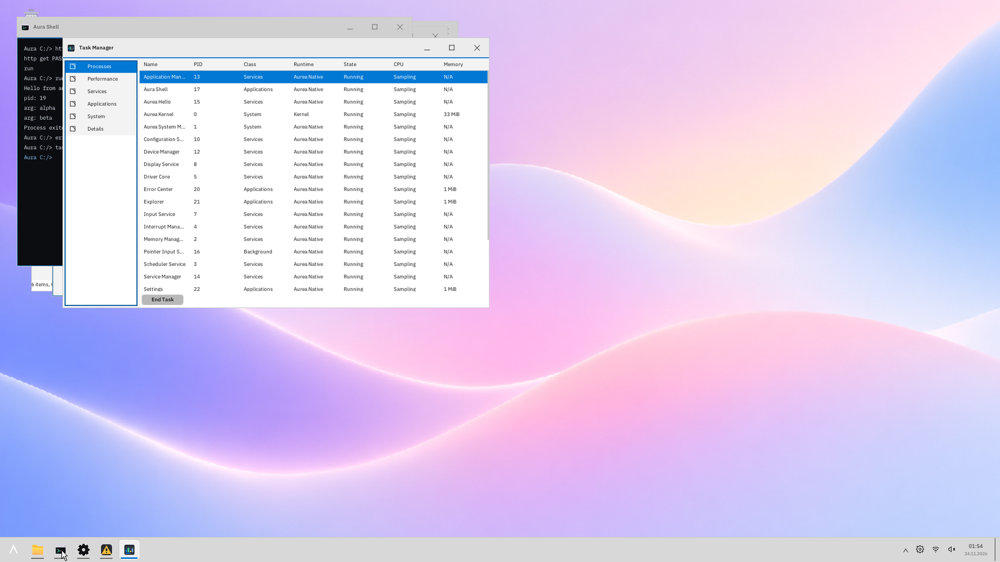 Task Manager |
| 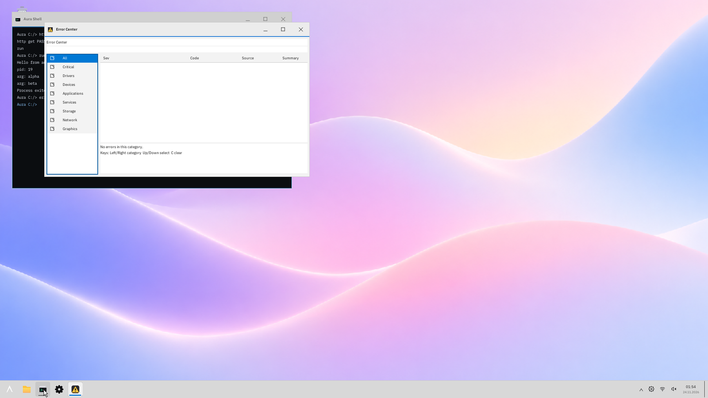 Error Center | 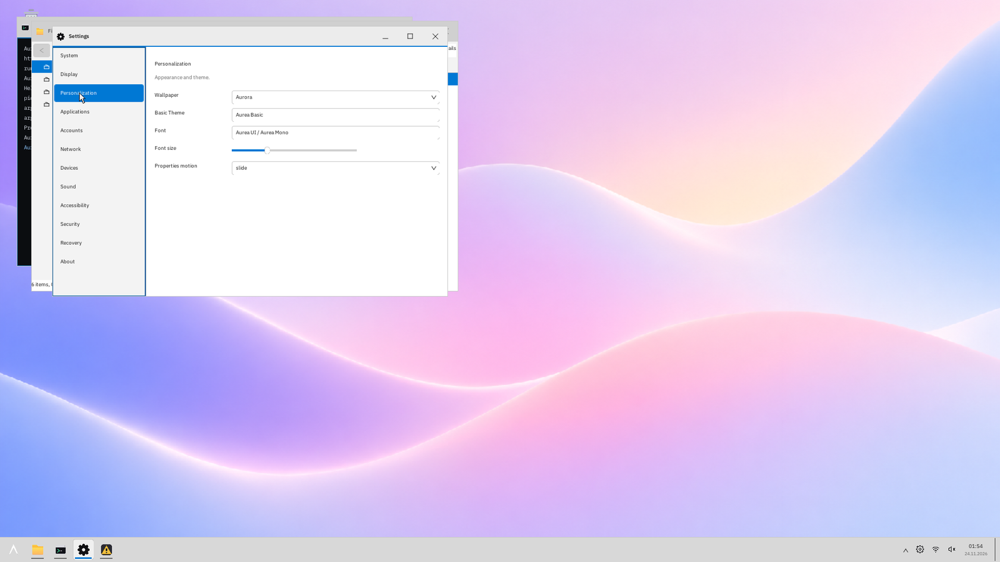 Settings, Personalization |

## What currently works

Tested with build 02416 in QEMU 11.0 on Windows 11 with WHPX acceleration, one virtual CPU and 1 GiB of memory.

| Area | Status | Notes |
|---|---|---|
| UEFI boot to the login screen | Verified | The login screen appeared within 40 seconds in every test run. |
| Login and desktop session | Verified | Development account `Aura` / `root`. |
| Horizon desktop, taskbar, Start menu | Verified | |
| File Explorer, Settings, Task Manager, Error Center | Verified | Opened and displayed; not every action was exercised. |
| Aura terminal and command registry | Verified | 163 registered commands; see [docs/COMMANDS.md](docs/COMMANDS.md). |
| File operations on the C: drive | Verified | C: is held in memory in the release image; nothing persists. |
| Network (Intel e1000, DHCP) | Partial | DHCP and `http get` work under QEMU user networking. |
| Native applications (`run`) | Verified | SDK-built programs and the bundled sample run in user mode, print to the Aura window and exit cleanly. |
| GNU Bash via the Linux driver domain | Partial | Works under QEMU/KVM with nested virtualization on Linux. Not available under Windows QEMU (WHPX). |
| AureaFS | Not in this image | Implemented in the kernel, but the release image runs from memory and does not mount it. |
| SMP | Not verified | The release configuration starts one CPU. |
| SoftCPU | Not in this build | Excluded from release builds; development builds only. See [docs/SOFTCPU.md](docs/SOFTCPU.md). |
| Real hardware boot | Experimental | Earlier builds booted on one laptop; build 02416 has not been tested on hardware. |
| VirtualBox | Not verified | |

## Known limitations

The full list is in [docs/LIMITATIONS.md](docs/LIMITATIONS.md). The ones that matter most:

- **No persistence.** The release image keeps the C: drive in memory. Everything is lost at shutdown.
- **No Bash in Windows QEMU.** The Linux driver domain needs hardware virtualization features that Windows' WHPX does not pass to the guest.
- **The user-mode environment is highly experimental.** Ring 3 execution exists, but the system call surface is small, isolation has not been fully tested, and the desktop applications themselves still run inside the kernel.
- **Graphics and input are unoptimized.** Expect latency, slow redraws and windows that behave inconsistently.
- **Occasional freeze.** In one of about ten test sessions the system stopped responding shortly after login. The cause is not known yet; restart the VM if it happens.

## Language, keyboard and fonts

All documentation is in English. The operating system itself differs in a few ways:

- **Interface language.** Most system text in Milestone 1 is English: the desktop, Start menu, Explorer, Settings, Task Manager, Error Center and the Aura terminal. Dates use the German format (`23.11.2026`) and the default time zone is Europe/Berlin. There is no translation system and no runtime language selection.
- **Keyboard.** Input is designed around a **German QWERTZ layout**, which is the default. `keyboard layout set ENG` switches to US QWERTY for the current session; the setting is not saved. Other layouts, input methods (IME) and dead-key composition are not supported.
- **Fonts.** The interface uses IBM Plex Sans and IBM Plex Mono (listed in Settings as "Aurea UI" and "Aurea Mono"), rendered by a built-in TrueType rasterizer, with an 8×8 bitmap font for early boot and crash screens. There is no font selection, no complex text shaping, no right-to-left text and no fallback fonts for scripts those two families do not cover.

## Zero Core architecture

Zero Core is the Aurea kernel. In the intended design it keeps final authority over processes, memory, devices and permissions, and every runtime (native, compatibility or driver domain) goes through it.

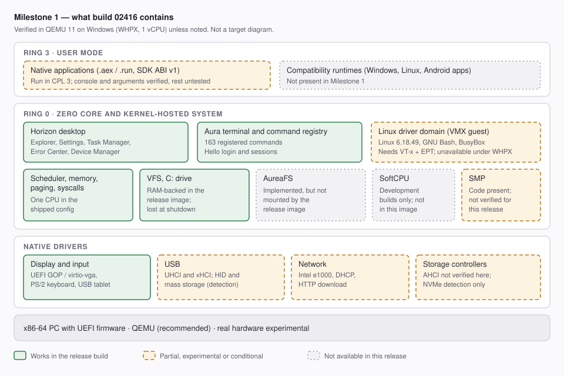

The diagram shows build 02416 as it is. In Milestone 1 the desktop and the system applications still run in kernel mode; only external applications run in Ring 3. [docs/ARCHITECTURE.md](docs/ARCHITECTURE.md) explains the current structure and the intended one.

## Horizon desktop

Horizon is the Aurea desktop: wallpaper, desktop icons, taskbar, a Start menu with search, window management (minimize, maximize, close), and the system applications File Explorer, Settings, Task Manager, Error Center and Device Manager. Milestone 1 ships one visual theme, Aurea Basic.

Horizon is drawn by Aurea's own software compositor; there is no GPU acceleration. On the test host it is responsive enough to explore, but it is not smooth, and some interactions are slow or inconsistent.

## Download and quick start

1. Open the [Milestone 1 release](../../releases/tag/milestone-1) and download:
   - `AureaOS-Milestone1-build02416.img`
   - `AureaOS-Milestone1-tools.zip`
   - `SHA256SUMS.txt`
2. Install [QEMU for Windows](https://qemu.weilnetz.de/w64/) (64-bit). On Linux, install QEMU and OVMF from your distribution; see the QEMU guide.
3. Extract the tools into a folder and put the image and `SHA256SUMS.txt` next to them.
4. Double-click **`Aurea Live VM.cmd`**. It verifies the checksum and starts the VM.
5. Log in as `Aura` with password `root`.

To stop, run `power shutdown` in the Aura terminal or close the QEMU window.

## Running Aurea in QEMU

QEMU is the recommended environment for Milestone 1. The launcher uses the tested configuration:

| Setting | Value |
|---|---|
| Machine | `pc`, with the edk2 UEFI firmware shipped with QEMU |
| Accelerator | WHPX on Windows (falls back to TCG), KVM on Linux |
| CPU | `qemu64`, 1 vCPU |
| Memory | 1024 MiB (512 MiB also reached the desktop in testing) |
| Graphics | `virtio-vga` at 1920×1080 |
| Input | PS/2 keyboard, USB tablet |
| Network | Intel e1000, QEMU user networking |
| Disk | The release image in snapshot mode; the file is never modified |

Full instructions, Linux commands and troubleshooting: [docs/INSTALL_QEMU.md](docs/INSTALL_QEMU.md).

## Experimental USB boot

Booting real hardware is possible but experimental. **`Aurea Live boot.cmd`** writes the release image to a USB drive. It offers only USB-attached disks, refuses system and boot disks, requires a typed confirmation, and reads the drive back afterwards to verify the write.

The image is 128 MiB, so any USB drive of 256 MB or more is large enough. Everything on the selected drive is erased.

The shipped configuration mounts internal disks read-only (`storage.internal_readonly=true`), but you should still use a dedicated test machine and keep backups. Read [docs/HARDWARE_BOOT.md](docs/HARDWARE_BOOT.md) first.

## Aurea SDK

The [`sdk/`](sdk) folder contains the public application interface: C headers for system calls 0–42 (console, files, directories, memory, time, dialogs, windows and events, sockets, DNS, clipboard), a small runtime, the linker script, the AEX/RUN packager and an example.

The SDK builds with clang and ld.lld on Linux or WSL, and the example compiles without warnings. In my tests, SDK-built programs downloaded into Aurea ran with their arguments, printed to the Aura window and exited cleanly. The interface is small and young, and only part of it has been exercised from an application; [docs/SDK.md](docs/SDK.md) says exactly what was tested.

## Building and installing applications

There is no graphical installer and no package store in Milestone 1. The developer path that exists:

1. Build the application with the SDK.
2. Serve the output folder over HTTP on the host (`python -m http.server 8000`).
3. In Aura: `http get 10.0.2.2 8000 /hello.run C:/hello.run`.
4. Run it: `run C:/hello.run`.

Programs placed on C: are gone after a restart, because the release image keeps C: in memory. Details: [docs/APPLICATIONS.md](docs/APPLICATIONS.md).

## Aura terminal and command registry

Aura is the Aurea command environment, opened from the taskbar or the desktop. Every command is registered with a name, category, usage line and permission level. `help` lists the categories, `help <command>` shows details and `commands` lists everything.

Milestone 1 registers 163 commands. Many of them are diagnostic tools from my own development work and are documented as such. The reference is in [docs/COMMANDS.md](docs/COMMANDS.md).

Aura commands are Aurea's own, not Bash commands, even where the names (`ls`, `cd`, `ps`) are familiar.

## GNU Bash and Linux integration

The `bash` command opens an interactive GNU Bash 5.2 session inside the Linux driver domain: a Linux 6.18.49 kernel with a small initramfs (Bash and BusyBox) running in a VMX virtual machine that Aurea manages itself. The terminal appears inside the Aura window. `exit` or Ctrl+D returns to Aura; Ctrl+] detaches and leaves the shell running.

This needs Intel VT-x with EPT available to Aurea:

- **Windows QEMU (WHPX):** not available. `bash` reports that the host lacks the required VMX controls.
- **QEMU with KVM and nested virtualization on Linux:** works with the release image. The Linux domain reported ready about 32 seconds after boot, and `bash` gave a working shell.
- **Real hardware:** Bash started on my test laptop with build 02405. Build 02416 has not been retested there.

The Linux guest has no access to Aurea's files or network in Milestone 1. It is a working terminal, not a Linux environment for running applications.

## SoftCPU

SoftCPU is an experimental software CPU: an interpreter inside the Aurea kernel that executes x86-64 code without hardware virtualization. I use it for development and compatibility experiments, such as studying Linux bring-up on hosts without usable VT-x. It is very slow, it is not how Aurea itself runs, and it is **not included in the Milestone 1 image**: release builds leave the interpreter out. See [docs/SOFTCPU.md](docs/SOFTCPU.md).

## Performance and stability

**Performance optimization is not the primary focus of Milestone 1.** Rendering is done in software, input passes through several layers, the shipped configuration logs heavily to the serial port, and only one CPU is used. Expect UI latency, slow window operations and bugs. A kernel fault ends in a red error screen with a fault summary; the system then has to be restarted.

## Security warning

Milestone 1 is not a hardened operating system:

- Ring 0 / Ring 3 separation exists for external applications, but the desktop and system applications run in kernel mode, and isolation has not been fully tested.
- The development account is an administrator, and its password is public.
- Passwords are stored as salted SHA-256 hashes, not with a slow password-hashing function.
- Nothing is encrypted at rest.
- Package integrity tags use a fixed development key. They detect damaged files, not untrusted authors.
- The boot files are unsigned; Secure Boot must be disabled to boot on hardware.

Do not store personal data in Aurea OS and do not rely on it for anything important. Details: [docs/LIMITATIONS.md](docs/LIMITATIONS.md#security).

## Current development focus

The next milestone is about the **Linux driver domain**: letting Linux supply real hardware drivers to Aurea through controlled interfaces, so that hardware support can grow without giving up Zero Core's authority. Today the domain boots Linux and runs an interactive shell; it does not yet pass any device to Linux or any driver service back to Aurea.

## Long-term architecture

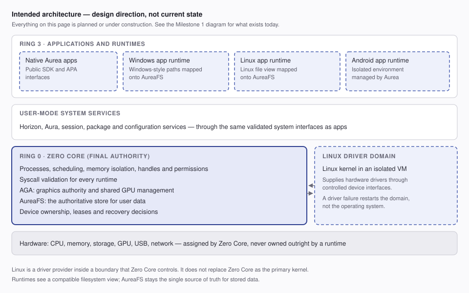

The long-term goal is a complete, independent operating system with its own kernel, native applications, controlled Linux driver capabilities, and separate runtimes for Windows, Linux and Android applications. Each runtime would present a compatible file system view to its applications while AureaFS remains the store that actually holds the data. AGA would be the single graphics authority managing GPU access for all of them.

None of these runtimes exist yet. [docs/ARCHITECTURE.md](docs/ARCHITECTURE.md) describes the plan and where it stands.

## Developer and credits

Aurea OS is an independently designed and developed operating system project by **66773**. AI-assisted engineering tools are used throughout development, while the architecture, technical direction and project decisions remain developer-led. I consider these tools a normal part of building software today; other ways of working are just as valid.

Third-party components are listed in [THIRD_PARTY_NOTICES.md](THIRD_PARTY_NOTICES.md).

## Licensing

- **SDK** ([`sdk/`](sdk)): MIT licence, see [sdk/LICENSE](sdk/LICENSE). Applications built with it can use any licence.
- **Documentation, tools and images:** © 66773. The Aurea OS images contain the third-party components listed below, which keep their own licences.

Aurea OS includes third-party software under its own licences, including the Linux kernel (GPL-2.0), GNU Bash (GPL-3.0-or-later), BusyBox (GPL-2.0), the GNU C Library (LGPL-2.1-or-later) and the IBM Plex fonts (SIL Open Font License 1.1). These components are not Aurea code. See [THIRD_PARTY_NOTICES.md](THIRD_PARTY_NOTICES.md) for their licences and for how to obtain their source code.

---

<b>with love by 66773</b>

