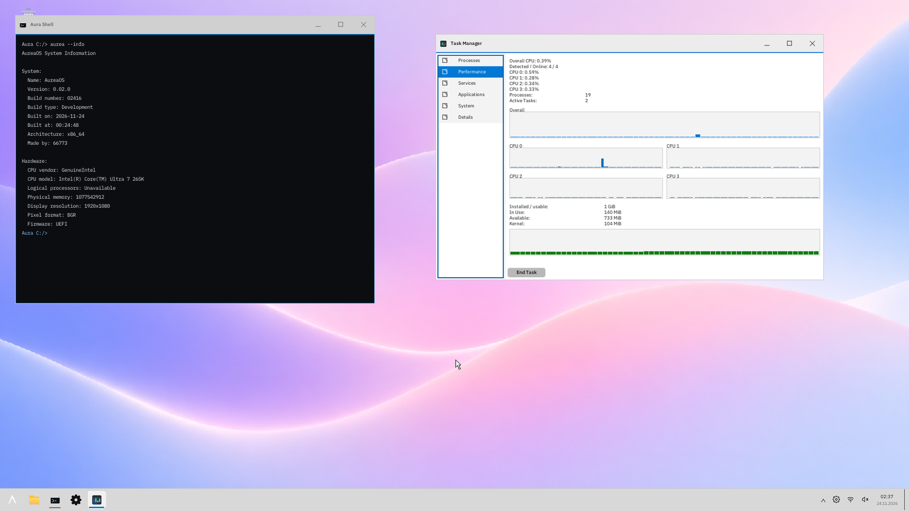

# Introducing Aurea OS

Aurea OS is a 64-bit operating system I am building from scratch. It has its own UEFI boot loader and its own kernel, Zero Core, with a scheduler, memory management, a desktop (Horizon) and a command environment (Aura). It is not a Linux distribution. Linux appears in one role only: as a guest that Zero Core starts and controls through Intel VMX.

I develop Aurea alone. I use AI-assisted tools throughout; the architecture and the decisions are mine.

## Milestone 1 — Linux Boot via Intel VMX

Zero Core can now set up a hardware-virtualized Linux environment with Intel VT-x and EPT, boot a Linux 6.18 kernel inside it, and attach an interactive GNU Bash session to the Aura terminal. This works on real Intel hardware and under QEMU/KVM.

What this milestone shows:

- Aurea boots natively on a tested Intel laptop (HP EliteBook 840 G8).
- Zero Core initializes VMX, runs a guest self-test and boots Linux 6.18.49 under its own VMX code. No host hypervisor is involved.
- GNU Bash 5.2 runs inside that guest and is used from the Aura terminal.
- Zero Core starts, stops and restarts the guest and owns its memory and devices.

What it does not show yet:

- Linux does not drive any hardware for Aurea. No device is passed to the guest, and no driver service comes back.
- The guest is not a finished driver domain: device ownership, resource mediation and recovery are not done.
- Hardware support is narrow. Only one Intel machine has been tested; AMD is not supported.
- Isolation and security are not production-ready.

The Linux guest is the foundation of the future driver domain. More detail: [docs/LINUX_GUEST.md](docs/LINUX_GUEST.md).



*Build 02416 in QEMU with four virtual CPUs (`boot.cores=all`): `aurea --info` in Aura, Task Manager on the performance view.*

## Run Aurea OS

Download from the [Milestone 1 release](../../releases/tag/milestone-1): `AureaOS-Milestone1-build02416.img`, `AureaOS-Milestone1-tools.zip` and `SHA256SUMS.txt`.

**In QEMU (recommended).** Install [QEMU for Windows](https://qemu.weilnetz.de/w64/), put the image and checksums next to the extracted tools and run `Aurea Live VM.cmd`. Log in as `aura` with password `root`. Linux hosts and details: [docs/INSTALL_QEMU.md](docs/INSTALL_QEMU.md).

**On Intel hardware.** Write the image to a USB drive with `Aurea Live boot.cmd`, disable Secure Boot, enable Intel Virtualization Technology and boot the drive in UEFI mode. The full walkthrough, from an empty USB drive to a Bash prompt, is in [docs/HARDWARE_BOOT.md](docs/HARDWARE_BOOT.md).

| Environment | Aurea desktop | Linux guest and Bash |
|---|---|---|
| Intel PC, VT-x + EPT | Experimental. Verified on an HP EliteBook 840 G8 | Verified on that machine with build 02412 |
| QEMU/KVM on Linux, nested VMX | Works | Verified with build 02416 |
| QEMU/WHPX on Windows | Works | Not available: WHPX does not pass the required VMX features to the guest |
| AMD processors | Not tested | Not supported (no AMD SVM backend) |

The download is build 02416. It is 02412 plus fixes for running native programs, and it also contains unfinished driver-domain code. **02416 has not been booted on real hardware yet;** the hardware results above are from 02412.

## Linux Guest & GNU Bash

Linux starts automatically during boot when the CPU allows it. In the Aura terminal:

```
Aura C:/> bash
root@linux:~# uname -a
Linux (none) 6.18.49 #2 SMP PREEMPT_DYNAMIC Wed Oct  7 17:32:56 CEST 2026 x86_64 GNU/Linux
root@linux:~# exit
Aura C:/>
```

That output is from the HP EliteBook run of build 02412. `exit` or Ctrl+D returns to Aura; Ctrl+] leaves Bash running in the background, and `bash` reattaches. The guest is a small initramfs with Bash and BusyBox. It has no disk and no network, and cannot see Aurea's files.

## Current State & Limitations

- One CPU by default (`boot.cores=1`). Four cores work in QEMU with `boot.cores=all`, including the Linux guest under KVM, but multi-core operation has not been tested on hardware.
- C: is held in memory; nothing persists across a restart.
- Software rendering, noticeable UI latency, German QWERTZ keyboard by default (`keyboard layout set ENG` for US).
- Native programs run in Ring 3, but the desktop and system applications still run in the kernel.
- Not hardened: the development account is an administrator with a public password, and nothing is encrypted.
- An occasional freeze shortly after login was seen in one of about ten test sessions.

Full list: [docs/LIMITATIONS.md](docs/LIMITATIONS.md).

## SDK & Documentation

- [docs/HARDWARE_BOOT.md](docs/HARDWARE_BOOT.md): USB boot on Intel hardware, step by step
- [docs/LINUX_GUEST.md](docs/LINUX_GUEST.md): how the VMX guest and Bash work
- [docs/INSTALL_QEMU.md](docs/INSTALL_QEMU.md): QEMU on Windows and Linux
- [docs/SDK.md](docs/SDK.md) and [`sdk/`](sdk): native applications (MIT licence)
- [docs/APPLICATIONS.md](docs/APPLICATIONS.md), [docs/COMMANDS.md](docs/COMMANDS.md): running programs, Aura commands
- [docs/ARCHITECTURE.md](docs/ARCHITECTURE.md), [docs/SOFTCPU.md](docs/SOFTCPU.md), [docs/LIMITATIONS.md](docs/LIMITATIONS.md)

## Next Milestone — Linux Driver Integration

Turning the bootable guest into a driver-service domain:

- discover physical devices and assign selected ones to the guest under Zero Core's control;
- load the matching Linux drivers and confirm that they initialize;
- establish a real data path between Zero Core and Linux and export controlled device capabilities to Aurea;
- keep Zero Core in charge of hardware resources, with diagnostics and recovery when a driver fails;
- start with input and storage, and test on more Intel machines.

I will not call the driver integration done until real device operations work through it. AMD support and broader hardware coverage come later.

## Developer

Aurea OS is designed and developed by 66773. The SDK is MIT-licensed; the documentation, tools and images are © 66773. The image contains third-party software under its own licences (Linux, GNU Bash, BusyBox, the GNU C Library, IBM Plex fonts); see [THIRD_PARTY_NOTICES.md](THIRD_PARTY_NOTICES.md). Their source code is on the release page.

---

**with love by 66773**
