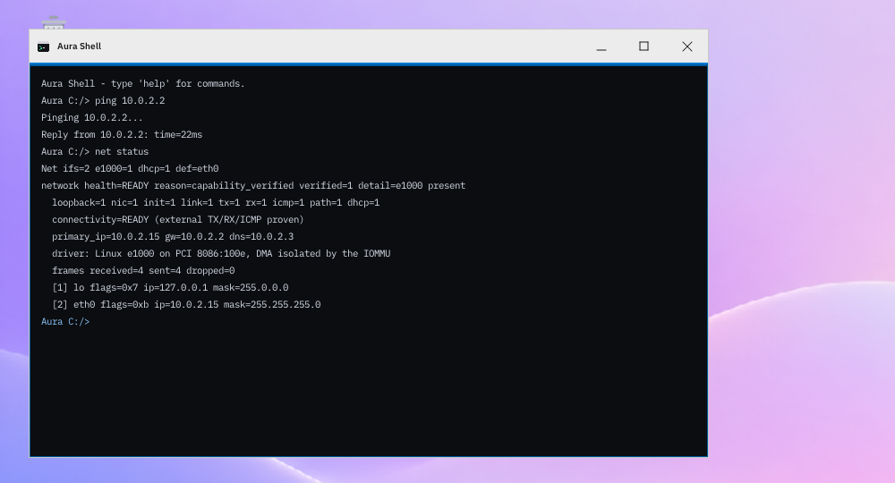
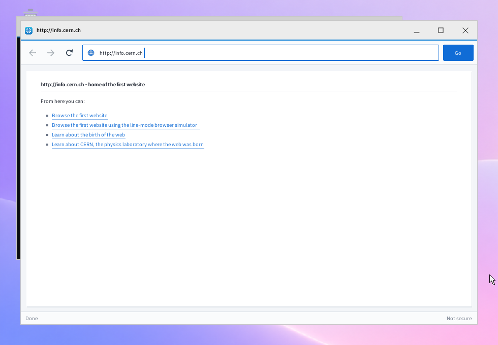

# Introducing Aurea OS

Aurea OS is a 64-bit operating system I am building from scratch. It has its own UEFI boot loader and its own kernel, Zero Core, with a scheduler, memory management, a desktop (Horizon) and a command environment (Aura). It is not a Linux distribution. Linux appears in one role only: as a guest that Zero Core starts and controls, and since Milestone 1.1, as the driver for a device that Zero Core hands to it.

I develop Aurea alone. I use AI-assisted tools throughout; the architecture and the decisions are mine.

## Milestone 1.1 — Linux drives its first device

In Milestone 1, Linux booted inside a guest under Zero Core and gave you a Bash prompt, but it could not touch any hardware. In 1.1 it does real driver work for Aurea for the first time: Zero Core assigns the network card to the Linux guest, the unmodified Linux `e1000` driver runs it, and every packet travels between that driver and Aurea's own TCP/IP stack over a channel that Zero Core controls.



*Build 02450 in QEMU on Windows (WHPX). `ping` and DHCP go through the Linux driver; `net status` names it.*

What 1.1 adds:

- **Device assignment.** At boot, Zero Core gives the network card to the Linux guest: a virtual PCI bus with the card's configuration space, its MMIO and I/O ranges and its interrupt. An Intel IOMMU (VT-d) confines the card's DMA to the guest's memory. Without an IOMMU nothing is assigned, and Aurea uses its own e1000 driver instead.
- **A driver that comes back.** A small Linux module hands received frames to Aurea and transmits Aurea's frames unchanged. Linux has no IP address on the card; addresses, ARP, TCP, DHCP and DNS stay in Aurea.
- **Linux on hosts without usable VMX.** If the CPU cannot give Aurea the VMX features it needs, as under QEMU with WHPX on Windows, the guest now runs on SoftCPU, Aurea's x86-64 binary translator. Linux is ready about 2.5 seconds after the domain starts, and Bash works there too. Milestone 1 had no Linux guest on Windows hosts at all.
- **More to try.** The image includes a Browser, Notepad, Snake Arena and a package with Freedoom, a native port of id Software's DOOM engine with free game data.



What 1.1 does not show yet:

- **Real hardware.** Everything above was verified in QEMU: on Windows (WHPX, SoftCPU) and on Linux (KVM, nested VMX). **Build 02450 has not been booted on a physical machine.** The last hardware results, from my HP laptop, are for build 02412 (Milestone 1).
- One device class (network), and in practice one driver (`e1000`). The guest kernel has more drivers and Aurea picks one by the device's PCI ID, but no other device has gone through this path in my tests.
- No Wi-Fi. No storage, input or audio through Linux yet.
- The isolation has not been audited or tested against a hostile guest.

More detail: [docs/LINUX_GUEST.md](docs/LINUX_GUEST.md) and [docs/SOFTCPU.md](docs/SOFTCPU.md).

## Run Aurea OS

Download from the [Milestone 1.1 release](../../releases/tag/milestone-1.1): `AureaOS-Milestone1.1-build02450.img`, `AureaOS-Milestone1.1-tools.zip` and `SHA256SUMS.txt`.

**In QEMU (recommended).** Install [QEMU for Windows](https://qemu.weilnetz.de/w64/), put the image and checksums next to the extracted tools and run `Aurea Live VM.cmd`. Log in as `aura` with password `root`. The 1.1 launcher starts a `q35` machine with an Intel IOMMU and an `e1000` card, which is what lets Linux drive the card. Linux hosts and details: [docs/INSTALL_QEMU.md](docs/INSTALL_QEMU.md).

**On Intel hardware.** Write the image to a USB drive with `Aurea Live boot.cmd`, disable Secure Boot, enable Intel Virtualization Technology and boot the drive in UEFI mode: [docs/HARDWARE_BOOT.md](docs/HARDWARE_BOOT.md). Build 02450 itself has not been tested on hardware.

| Environment | Aurea desktop | Linux guest and Bash | Network card driven by Linux |
|---|---|---|---|
| QEMU/WHPX on Windows (1.1 launcher) | Works | Works on SoftCPU (build 02450) | Works (build 02450, `e1000` + Intel IOMMU) |
| QEMU/KVM on Linux, nested VMX | Works | Works on VMX (build 02450) | Works (build 02450, `e1000` + Intel IOMMU) |
| Intel PC, VT-x + EPT | Experimental | Verified on an HP EliteBook 840 G8 with build 02412 | Not tested |
| AMD processors | Not tested | Not tested | Not tested |

## Linux guest & GNU Bash

Linux starts automatically during boot. In the Aura terminal:

```
Aura C:/> bash
root@linux:~# uname -a
Linux (none) 6.18.49 #2 SMP PREEMPT_DYNAMIC Tue Nov 24 00:18:01 CET 2026 x86_64 GNU/Linux
root@linux:~# exit
Aura C:/>
```

That output is from build 02450 under WHPX, where Linux runs on SoftCPU. `exit` or Ctrl+D returns to Aura; Ctrl+] leaves Bash running in the background, and `bash` reattaches.

## Current state & limitations

- Verified in QEMU only. Ten sessions of 02450 under WHPX and two under KVM reached Linux ready with the network card bound by Linux every time; none froze or crashed.
- One CPU by default (`boot.cores=1`), as in Milestone 1.
- C: is held in memory in the release image; nothing persists across a restart.
- Software rendering, noticeable UI latency, German QWERTZ keyboard by default (`keyboard layout set ENG` for US).
- When `bash` starts, the guest's driver-service messages from boot appear above the first prompt.
- Not hardened: the development account is an administrator with a public password, and nothing is encrypted.

Full list: [docs/LIMITATIONS.md](docs/LIMITATIONS.md).

## SDK & documentation

- [docs/LINUX_GUEST.md](docs/LINUX_GUEST.md): the Linux guest, device assignment and the network path
- [docs/SOFTCPU.md](docs/SOFTCPU.md): running the guest without VMX
- [docs/INSTALL_QEMU.md](docs/INSTALL_QEMU.md): QEMU on Windows and Linux
- [docs/HARDWARE_BOOT.md](docs/HARDWARE_BOOT.md): USB boot on Intel hardware, step by step
- [docs/SDK.md](docs/SDK.md) and [`sdk/`](sdk): native applications (MIT licence)
- [docs/APPLICATIONS.md](docs/APPLICATIONS.md), [docs/COMMANDS.md](docs/COMMANDS.md), [docs/ARCHITECTURE.md](docs/ARCHITECTURE.md): written for Milestone 1 and not fully rechecked for 1.1

## Next

- Boot 1.1 on hardware and get the network path working with a physical Intel network card behind VT-d.
- Wi-Fi through the same path: driver, firmware, and the scan and join operations Aurea still lacks.
- Input and storage as the next device classes, with recovery when a driver fails.

## Developer

Aurea OS is designed and developed by 66773. The SDK is MIT-licensed; the documentation, tools and images are © 66773. The image contains third-party software under its own licences (Linux, GNU Bash, BusyBox, the GNU C Library, the DOOM engine, Freedoom, BearSSL, IBM Plex fonts); see [THIRD_PARTY_NOTICES.md](THIRD_PARTY_NOTICES.md). Their source code is on the release page.

---

**with love by 66773**
