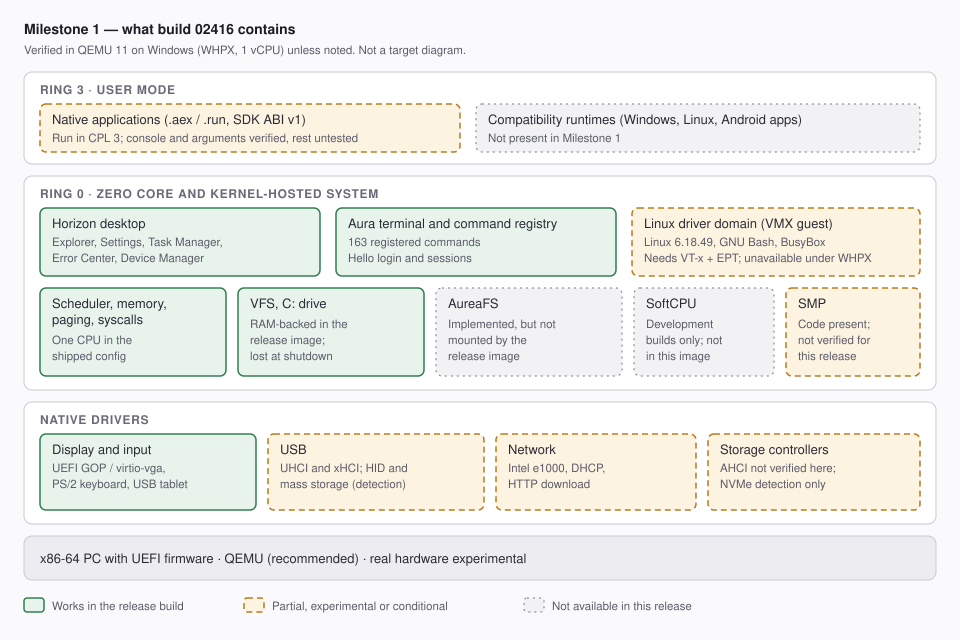
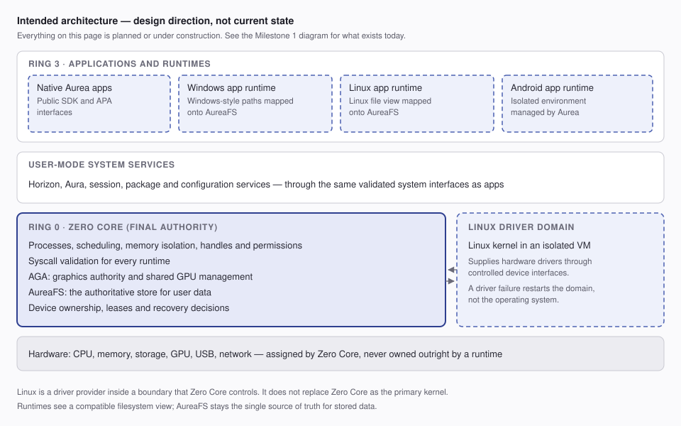

# Architecture

This page describes how Aurea OS is built today (Milestone 1, build 02416) and where it is meant to go. The two are kept apart on purpose: everything under [Intended architecture](#intended-architecture) is planned unless it says otherwise.

> **Milestone 1.1:** this page was written for Milestone 1 (build 02416) and has not been fully rechecked against build 02450. The Linux driver domain and SoftCPU sections below are updated. For what changed, see the [README](../README.md), [LINUX_GUEST.md](LINUX_GUEST.md) and [LIMITATIONS.md](LIMITATIONS.md).

## Milestone 1

### Boot

Aurea boots only through UEFI. Its own boot loader (`BOOTX64.EFI`) reads `boot.config`, shows a short boot menu, loads the ELF64 kernel, collects the memory map and the GOP framebuffer, leaves UEFI boot services and jumps into the kernel. The kernel brings up its subsystems in a fixed order (serial log, CPU, memory, paging, timer, scheduler, devices, VFS, display, compositor, window manager) and then hands the screen to the login screen.

### Zero Core

Zero Core is the Aurea kernel. In Milestone 1 it contains:

- **Processes and scheduling.** A process manager with process identity, roles and protection flags. Task Manager's *End Task* is refused for system processes. The scheduler runs kernel threads and user-mode processes. The release configuration uses one CPU.
- **Memory.** A physical memory allocator built from the UEFI memory map, 4-level paging with an identity-mapped low region, per-process address spaces for user programs, and NX for user stacks.
- **System calls.** `int 0x80` with 43 implemented calls (0–42), documented in [SDK.md](SDK.md).
- **Virtual file system.** Drive-letter paths. In the release image, C: is a RAM file system created at boot.
- **Devices and drivers.** A device registry and driver manager with built-in drivers for the UEFI framebuffer, PS/2 keyboard, USB (UHCI and xHCI host controllers, HID keyboards and pointers, mass storage), Intel e1000, AHCI, NVMe detection, AC97 and HD Audio, and ACPI.
- **Users and sessions.** User accounts, password authentication, interactive sessions and locking.
- **Configuration.** A typed configuration store (`config`, `reg`, `sysconf`).
- **Logging and errors.** Categorized kernel log, serial output, crash reports, and stable error codes collected by the Error Center.

### The desktop runs in the kernel

Horizon, the Aura terminal and the system applications (Explorer, Settings, Task Manager, Error Center, Device Manager) are compiled into the kernel and run in Ring 0 as kernel-hosted processes. They appear in Task Manager as *Aurea Native* processes. Only external applications loaded from `.aex` and `.run` files run in Ring 3.

This is the largest gap between Milestone 1 and the intended design. Moving system applications into user mode is planned.

### User mode

External applications run in Ring 3 in their own address space and reach the kernel only through system calls. A smoke test runs when the first application starts: it checks CPL 3 execution, a working system call, a writable user stack and NX on that stack. Protection of kernel memory against user code is part of the design but has not been systematically tested. Applications cannot map devices, access the framebuffer or start other processes.

### AureaFS

AureaFS is Aurea's own file system. It is implemented in the kernel and is used by development builds that boot from a prepared system volume. The Milestone 1 image does not contain an AureaFS volume, so the release runs entirely from memory and nothing persists. Making AureaFS part of the normal installation is planned.

### Linux driver domain

The Linux driver domain is a virtual machine that Aurea runs itself, using Intel VMX and EPT directly, without any host hypervisor, or SoftCPU where VMX is not usable. In Milestone 1 it contained Linux 6.18.49 with a small initramfs (GNU Bash 5.2, BusyBox 1.36), two emulated serial ports (the console and a control channel) and a timer. It starts automatically at boot when VT-x is usable. The `bash` command connects the Aura window to its console.

Since Milestone 1.1 it also drives one device for Aurea: with an Intel IOMMU present, Zero Core assigns the network card to the guest, the Linux driver runs it, and frames cross to Aurea's own network stack over a driver channel. It still shares no files with Aurea, and no other device class goes through it yet. Details: [LINUX_GUEST.md](LINUX_GUEST.md).

### SoftCPU

A binary translator in the kernel that runs the Linux guest when VT-x is not usable, for example under QEMU with WHPX. Part of the release image since 1.1. See [SOFTCPU.md](SOFTCPU.md).

## Intended architecture

### Zero Core as the final authority

Zero Core is meant to stay the single authority over processes, memory, devices, permissions and handles. Every other component, including system services, compatibility runtimes and the Linux driver domain, works through interfaces that Zero Core validates. No runtime gets privileged shortcuts.

### Proper Ring 0 / Ring 3 separation

System services and applications, including Horizon and the system applications, should run in user mode and use the same public interfaces as third-party applications. Today only external applications do.

### Linux as a driver provider

The driver domain is meant to let Linux drive hardware that Aurea has no native driver for:

- Zero Core assigns a device to the domain through controlled interfaces (device leases), with DMA and interrupts confined to that device.
- The domain exposes the device back to Aurea as a service, for example storage, network or input.
- If a driver crashes, Zero Core restarts the domain; the rest of the system keeps running.
- Aurea's own services do not depend on Linux wherever that can be avoided.

Linux in this role is a driver provider inside a boundary that Zero Core controls. It does not replace Zero Core as the primary kernel.

### Application runtimes

Separate runtimes are planned for Windows, Linux and Android applications, each running in an environment managed by Aurea. A runtime would present a file system view its applications expect, such as Windows-style drive paths for Windows applications, while the data itself lives in AureaFS. Native Aurea applications use the SDK directly; compatibility applications go through their runtime. None of these runtimes exist yet, and full binary compatibility is not a goal I can promise.

### AGA

AGA is the planned graphics authority: one component that owns the GPU and decides which runtime or application may use it and how, so that native and compatibility applications can share graphics hardware safely. Milestone 1 has no GPU driver and draws everything in software.

### Encryption and security

Storage encryption, real code signing and a hardened permission model are planned. None of them protect data in Milestone 1; see [LIMITATIONS.md](LIMITATIONS.md#security).
