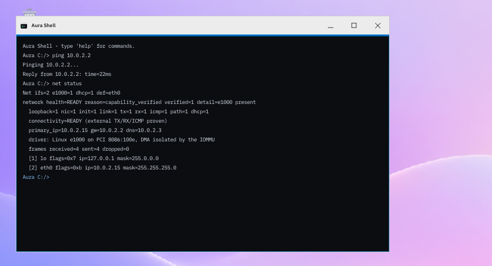

# The Linux guest: VMX, SoftCPU, Bash and the first driver

Zero Core boots a Linux kernel inside a guest that it controls. Milestone 1 showed the guest and an interactive GNU Bash in the Aura terminal. Milestone 1.1 adds the first real driver work: Zero Core gives the network card to the guest, Linux drives it, and Aurea's own network stack uses it.

Three different things are easy to mix up:

1. **A Linux guest boots.** Since Milestone 1, on real Intel hardware and under QEMU/KVM; since 1.1 also under QEMU/WHPX through SoftCPU.
2. **GNU Bash runs inside that guest.** Same configurations.
3. **Linux device drivers provide services to Aurea.** New in 1.1, for one device class (network) and verified in QEMU only. Build 02450 has not been tested on hardware.

## Why Linux, and why under Zero Core

Aurea needs a lot of hardware drivers that I cannot write from scratch in reasonable time. Linux has them. The plan is to run Linux as a guest under Zero Core and let it drive selected devices, without making Linux the operating system's kernel. The guest must run fast, but every access to memory and devices outside its assignment must stop in Zero Core.

### Intel VMX

Aurea programs Intel VMX directly. There is no KVM, Xen or other host hypervisor underneath. The VMX code uses:

- **EPT** (Extended Page Tables), so the guest's physical memory is a region that Zero Core allocated and maps;
- **unrestricted guest**, so Linux can start in 32-bit protected mode as it expects;
- **external-interrupt exiting**, **acknowledge-interrupt-on-exit** and the **VMX-preemption timer**, so host interrupts and time slices stay with Zero Core while the guest runs (each guest run is bounded to a few milliseconds);
- **interrupt-window exiting**, to inject interrupts into the guest when it can take them.

AMD SVM is not implemented.

### SoftCPU

If one of those VMX features is missing, as under QEMU with WHPX on Windows, the guest runs on [SoftCPU](SOFTCPU.md), a binary translator in the Aurea kernel. It runs the same kernel and initramfs with the same emulated devices. Under WHPX, Linux was ready 2.5–2.7 seconds after the domain started in my tests of build 02450.

## How Zero Core starts the guest

1. At boot, Zero Core reads the VMX capability MSRs and, where VMX is available, runs VMXON/VMXOFF and a tiny test guest (hardware diagnostics H03–H05).
2. It looks for a network card it can hand over (see below) and, if there is one and an IOMMU, assigns it to the guest.
3. With `linux.autostart=true` (the default in the release image), the domain manager allocates 128 MiB of guest memory and loads the Linux kernel and initramfs that are embedded in the Aurea kernel image.
4. It enters the guest at the kernel's 32-bit entry point on VMX or SoftCPU, and runs it in bounded slices from its own scheduler.
5. When the initramfs reports ready, Bash is available to Aura, and the driver service in the guest starts binding drivers.

`domain linux status`, `domain linux start` and `domain linux stop` control the guest by hand.

## What the guest is

| | Build 02450 |
|---|---|
| Kernel | Linux 6.18.49, unmodified source, guest configuration with loadable, signed modules |
| Command line | `console=ttyS0,115200 earlycon=uart,io,0x3f8,115200n8 panic=-1 aurea_domain=1 noapic nolapic pci=conf1,nomsi ipv6.disable=1 clocksource=tsc tsc=reliable no_timer_check` |
| CPUs | 1 |
| Memory | 128 MiB |
| Initramfs | GNU Bash 5.2.21 (static), BusyBox 1.36.1, the Aurea driver service, the Aurea network and I2C modules, a few HID/I2C modules, two small Aurea helpers, an init script |
| Emulated hardware | 8259 interrupt controller, 8254 timer, MC146818 clock, two 16550 serial ports, a PCI host bridge |
| Real hardware | The assigned network card, if any, at 00:02.0 on the guest's PCI bus |

The source code for the kernel, its configuration, the modules, Bash, BusyBox, the C library and the helpers is on the release page (`AureaOS-Milestone1.1-third-party-source.tar`).

## Device assignment and the network path

This is what is new in 1.1.

**Choosing the device.** Zero Core scans PCI for network controllers. It reads which drivers the embedded Linux kernel has from the kernel's own module aliases, and assigns a card only when Linux has a driver for it. Paravirtual devices (virtio) are skipped, because their DMA bypasses the IOMMU.

**Isolating it.** Assignment needs an Intel IOMMU (VT-d). Zero Core programs it so that the assigned card can reach only the guest's memory; every other device keeps an identity mapping. Without an IOMMU, nothing is assigned and Aurea drives the card with its own e1000 driver, as in Milestone 1. The boot log says which case applies:

```
[DRIVER] network 00:01.0 8086:100e assigned to the Linux domain, DMA limited to its memory
```

**What the guest sees.** A small virtual PCI bus: a host bridge and the card at 00:02.0. Configuration space is mediated by Zero Core; the card's MMIO and I/O ranges are mapped into the guest. Zero Core keeps the card's interrupt masked on the host, checks its interrupt status (every 0.1 ms while traffic flows, every 1 ms otherwise) and injects the interrupt into the guest. There is no MSI.

**Binding the driver.** The driver service in the guest finds the device and loads the matching driver, here the unmodified Linux `e1000`. Then it loads `aurea_driver_net`, a small Aurea module that takes over the interface's receive path and transmits what Aurea sends:

```
[DRIVER] network eth0 bound by Linux driver e1000 mac=52:54:00:12:34:56
```

**The data path.** Frames cross between `aurea_driver_net` and Zero Core over the driver channel, a shared-memory path that Zero Core sets up; a doorbell interrupt tells the guest when frames are waiting. Linux never gets an IP address on the card (`ip addr` in the guest shows `eth0` up without an address); ARP, IPv4, ICMP, TCP, DHCP and DNS run in Aurea. In the Aura terminal, `net status` shows the driver:

```
driver: Linux e1000 on PCI 8086:100e, DMA isolated by the IOMMU
frames received=4 sent=4 dropped=0
```



## Where Bash runs and how Aura talks to it

Bash runs as an ordinary process inside the Linux guest, as root, on the guest's first serial port (`ttyS0`). A helper in the initramfs (`aurea-console-session`) starts it as the session leader, so Bash has a real controlling terminal with job control.

Zero Core's emulated serial port carries the terminal stream between the guest and the Aura window:

- Keystrokes from Aura go into the guest's `ttyS0`.
- Bash's output is decoded by a terminal emulator in Aura (colors, cursor movement, line editing).
- A second serial port (`ttyS1`) carries control messages only: session start and end, window size (so `stty size` and full-screen programs match the Aura window) and redraw requests.

`bash` in Aura attaches the window to that session. `exit` or Ctrl+D ends the shell and returns to Aura; the guest's init starts a new shell for the next `bash`. Ctrl+] detaches and leaves the shell running.

In 1.1 the driver service writes its start-up messages to the same console, so they appear above the first Bash prompt.

## What the guest can and cannot do

The guest can run the programs in its initramfs: Bash built-ins and the BusyBox tools. Everything it writes stays in its own memory. It drives the assigned network card for Aurea, but it has no network access of its own.

It cannot see Aurea's files, disks or any device other than the assigned card. It cannot run programs that are not in the initramfs, and there is no package manager. Linux applications are not integrated into Aurea; this is a driver host with a shell, not a Linux compatibility layer.

## Verified configurations

| Configuration | Build | Evidence |
|---|---|---|
| QEMU 11 with WHPX on Windows 11, `q35`, Intel IOMMU, `e1000` (the 1.1 launcher) | 02450 | Ten sessions: Linux on SoftCPU ready 2.5–2.7 s after the domain started, `e1000` bound by Linux every time; ping, DHCP, `http get`, Browser on `info.cern.ch`; Bash, `uname -a`, `ip addr` |
| QEMU 8.2 with KVM, nested VMX (`-cpu host`), `q35`, Intel IOMMU, `e1000` | 02450 | Two sessions (image as a USB stick, and as a disk with the command from INSTALL_QEMU.md): Linux on VMX ready 11–17 s after boot, `e1000` bound by Linux, DHCP bound |
| HP EliteBook 840 G8, Intel Tiger Lake | 02412 | Milestone 1: two physical boots, H03–H05 passed, Linux ready about 40 s after the guest started, interactive Bash. No device assignment in that build. |

Build 02450 has not been booted on real hardware. Whether the HP's firmware exposes a usable VT-d unit, and whether one of its network devices can take this path, is still open.

## What is missing before this is a driver domain

- **More device classes.** Storage, input, audio and Wi-Fi do not go through Linux yet. Wi-Fi needs firmware, a driver build with it, and scan/join operations on the driver channel.
- **Hardware.** The path has only run in QEMU.
- **Recovery, tested.** The kernel supervises the network driver and can quarantine it and restart the guest when it stops answering, but I have not tested that with build 02450.
- **Security review.** The VMX/SoftCPU boundary, the IOMMU setup and the driver channel have not been audited or attacked.

## The file-system guest

The Aurea kernel also carries a second Linux build (`6.18.49-aureafs1`, with FUSE built in) for an experiment with file-system access through a guest. It is not used in normal operation.
